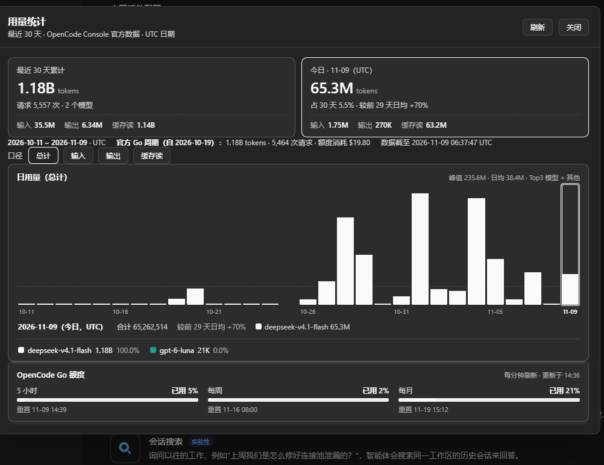
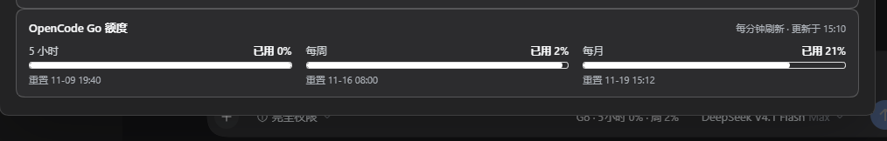

# dsh-opencode-go-usage

DSH（DeepSeek Harness）Web GUI 插件：查看 **OpenCode Go 订阅**最近 30 天的**分模型 token 消耗**，
以及 5 小时 / 每周 / 每月额度余量。入口在设置页、左侧栏按钮和悬停卡，数据直接来自
OpenCode Console 官方接口。

> 维护者与 AI 代理：开始改动前请先读 [AGENTS.md](./AGENTS.md)，其中记录数据口径、
> DSH 插件契约、缓存设计与验证方式。



## 功能

- **日用量堆叠柱状图**：最近 30 天每天一根柱，Top3 模型 + 「其他」最多 4 个系列；
  口径可切换总计 / 输入 / 输出 / 缓存读；悬停任意柱子看当天明细。
- **汇总块**：最近 30 天累计（token、请求数、模型数、分项）与今日（UTC）用量及对比。
- **OpenCode Go 额度**：5 小时 / 每周 / 每月三条进度条，白色描边 + 透明底，
  **白色 = 剩余额度，空白 = 已用**；每分钟刷新。
- **多种入口**
  - 左侧栏底部「GO 用量」按钮，点击打开浮层大面板；
  - 快捷键 `Ctrl+Shift+G`（macOS `Cmd+Shift+G`）开关面板；
  - 悬停按钮在右侧弹出 Codex 风格紧凑卡：`Usage source: OpenCode Go` +
    三项 `% left` + 「管理用量」；
  - 设置 → 用量统计（完整页面，共用同一份数据）。
- **快速打开**：Host 按 UTC 日缓存已完成日期的聚合结果并后台预热，缓存命中时打开低于 1 秒；
  首次安装仍需拉取 30 天日志（约 4–12 秒）。



## 数据来源与隐私

- 30 天 token 明细：`GET https://opencode.ai/console/api/request-logs/export`（按 UTC 日窗口）。
- 官方 Go 周期图：`GET https://opencode.ai/console/api/activity/go`。
- 额度余量：`GET https://opencode.ai/zen/go/v1/usage`。
- API Key 仅在本机 DSH Host 进程内读取（默认从 `$DSH_HOME/.credentials.yaml` 或
  `DSH_OPENCODE_GO_*` 环境变量），**不会下发到浏览器，也不会上传到任何第三方服务器**。
- 除 OpenCode 官方接口外没有其它网络请求；无遥测。
- 本地缓存文件：`$DSH_HOME/cache/dsh-opencode-go-usage/day-aggregates.v1.json`（只存日聚合）。

## 与其它插件的配合

- **推荐与 [`dsh-opencode-go`](https://www.npmjs.com/package/dsh-opencode-go) 一起使用**：
  后者提供 DSH 的 OpenCode Go provider 与账号/Key 配置，本插件读取同一份凭据做只读统计。
- 不硬依赖其它插件；与 `dsh-better-sidebar` 等 UI 插件可共存（本插件只占用
  `settings.section`、`sidebar.footer.action`、`shell.overlay` 三个扩展点，不改动宿主 UI）。
- 验证环境：DSH **0.2.2-rc.1**。DSH 升级后若设置页、侧栏按钮或浮层不显示，通常是 slot 契约变化，
  按 [AGENTS.md](./AGENTS.md) 的验证流程排查。

## 安装

目前未发布到 npm，按源码方式以 profile `link:` 依赖安装：

```powershell
git clone https://github.com/Donotinvert/opencode-go-usage-stats.git
# 记住克隆下来的绝对路径，例如 <repo>
dsh plugin --profile <profile> add "link:<repo>"
```

> `dsh plugin` 会把剩余参数转发给 profile 目录里的 pnpm；也可以用 DSH 桌面版自带的
> node + pnpm 手动执行 `pnpm add "link:<repo>"`，见 [AGENTS.md](./AGENTS.md)。

随后在 `~/.dsh/profiles/<profile>/cordis.patch.yml` 末尾追加挂载行：

```yaml
- insert:
    - id: usage-stats
      name: "dsh-opencode-go-usage"
```

硬刷新浏览器页面（Ctrl/Cmd+Shift+R）即可看到入口。修改 `index.js`（Host 半侧）后需要
重启 DSH 桌面应用；只改 `client.js` 时硬刷新即可。

> 如果你在 DSH 桌面版（Electron）中使用，`dsh plugin` 命令可能不在 PATH 里；直接使用
> 安装目录 `resources/runtime/primary-runtime/dependencies/` 下自带的 node/pnpm 即可。

## 注意事项

- 只统计 OpenCode Console 记录的 Go 计划流量；Console 请求日志保留 30 天，更早日期显示 0。
- Go 额度以美元计量，不同模型单价不同，因此页面展示 token 数量与额度百分比两个维度。
- 首次安装或缓存为空时第一次打开较慢（4–12 秒）；之后由磁盘缓存和后台预热保证秒开。
- 页面文案目前为中文，主要针对深色主题设计。
- 本项目与 OpenCode、DeepSeek 官方无隶属关系；Console 接口属于未公开文档的接口，
  上游变更可能导致数据暂不可用，届时按 AGENTS.md 的接口说明调整。

## 开发与测试

```powershell
node --check index.js
node --check client.js
node scripts/smoke.mjs          # 真实 Console 数据 + 缓存断言
node scripts/render-check.mjs   # 无浏览器、最小 React 替身的渲染断言
```

工程约定、数据口径、DSH 插件契约、缓存/验证细节与排障步骤见 [AGENTS.md](./AGENTS.md)。

## License

[MIT](./LICENSE)
